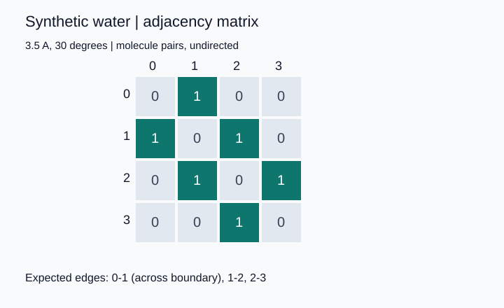
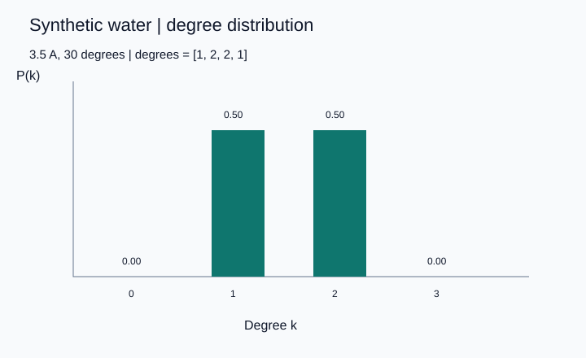
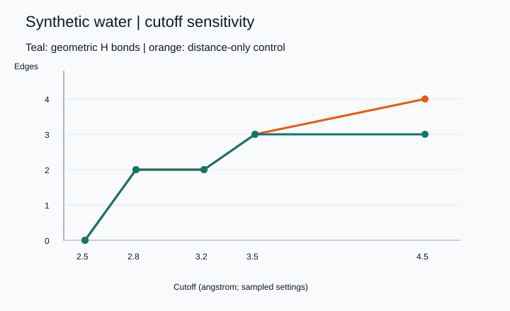

# Water hydrogen-bond networks under periodic boundaries

A small, reproducible computational chemistry demo using four synthetic water-shaped molecules. It shows how periodic geometry and an explicit hydrogen-bond definition become a molecular graph, and how changing the distance cutoff changes that graph.

**Status:** public educational portfolio demo, released under the MIT License. Drafted with AI assistance; reviewed and approved for release by the repository owner on 2026-10-15. No laboratory source code, trajectories, unpublished results, server configuration, or private project records are included. This demo demonstrates software verification; it does not establish a new physical result or validate a water force field.

## Run

Requires Python 3.12 (tested with 3.12.14). Uses only the Python standard library; no package installation is needed.

```sh
python -m unittest -v
python run_demo.py
```

Run these commands from this folder. `run_demo.py` deterministically regenerates the synthetic JSON input, CSV/JSON analysis, and three SVG plots in `results/`. It overwrites only those demo outputs. Open SVGs in a browser. `python generate.py` regenerates the input alone. There is no random coordinate sampling, external download, simulation engine, or GPU requirement. Tests and the demo each took less than one second in the preparation environment; no performance claim for large systems is intended.

## What is calculated?

All lengths are in angstrom. The box is orthorhombic, with side lengths 12 A. For each component of a displacement, the minimum-image mapping is

`delta_MIC = delta - L * floor(delta / L + 0.5)`.

It maps to `[-L/2, L/2)`. The distance cutoff must be strictly less than half the shortest box length. This avoids selecting a pair at an ambiguous half-box distance. This implementation does not support triclinic cells.

A donor molecule i and acceptor molecule j form a directed geometric hydrogen bond if:

- The minimum-image O_i–O_j distance is at most the distance cutoff.
- At least one of i's two O–H vectors makes an angle of at most 30 degrees with O_i–O_j, measured **at the donor oxygen**. Zero degrees means alignment.

Both O–O and O–H vectors use PBC, so independently wrapped hydrogen coordinates remain usable. Molecule-to-hydrogen membership is provided explicitly by the input; inferring bonds from a trajectory is outside scope. Floating-point boundary comparisons use tolerances of 1e-12 A and 1e-12 in cosine space.

The default distance cutoff is 3.5 A. This geometric definition follows the distance/angle convention documented in the [GROMACS hydrogen-bond analysis manual](https://manual.gromacs.org/2026.4/onlinehelp/gmx-hbond.html). The code is a new implementation; it does not call or reproduce GROMACS source code. Cutoffs are analysis choices, not universal physical constants.

The undirected adjacency matrix is `A[i,j] = directed[i,j] OR directed[j,i]`. Its diagonal is zero. Multiple qualifying hydrogens do not create multiple graph edges. Degree is the row sum of A; P(k) is the fraction of molecules of degree k. A separate distance-only graph is a control and is never labeled a hydrogen-bond graph.

## Hand-checkable expectations

At 3.5 A and 30 degrees, the edges are 0–1, 1–2, and 2–3. The first crosses the box boundary: its naive distance is 9.3 A, but its minimum-image distance is 2.7 A. Degrees are `[1, 2, 2, 1]`, so P(1) = P(2) = 0.5.

| Distance cutoff (A) | Hydrogen-bond pair edges | Distance-only pair edges |
|---:|---:|---:|
| 2.5 | 0 | 0 |
| 2.8 | 2 | 2 |
| 3.2 | 2 | 2 |
| 3.5 | 3 | 3 |
| 4.5 | 3 | 4 |

At 4.5 A, an extra distance neighbor fails the angular condition. Increasing a distance cutoff cannot remove an edge when coordinates and the angle criterion are fixed. Connecting lines in the cutoff plot guide the eye between sampled settings; they do not represent a fitted continuous curve.





## Verification and limits

Tests check the exact toy graph, an independent 27-image distance enumeration, wrapping/translation invariance, permutation invariance, distance and angle boundaries, invalid input, and graph identities. Passing tests validates these examples, not an MD workflow or experimental interpretation.

Additional cases check donation through the second hydrogen, merging bidirectional donations into one pair edge, an isolated molecule, exclusion of ambiguous half-box pairs even within the numerical tolerance, and end-to-end generation of reproducible CSV/JSON/SVG artifacts. The suite currently contains 16 tests. Generated text uses LF line endings across platforms.

A GitHub Actions workflow is included in `.github/workflows/tests.yml`. It runs the tests, regenerates outputs, and checks for differences against the committed example. Action versions are pinned to commit hashes. See the [Actions page](https://github.com/Youngchae2Lee/water-hbond-pbc-demo/actions) for the current CI status; local test results and hosted CI results are separate checks.

The synthetic coordinates are deliberately arranged, not equilibrated or sampled from a water model. The O–H length and H–O–H angle only make the molecules water-shaped; there are no charges, virtual sites, forces, thermodynamics, or force-field claims. Four molecules cannot support bulk distributions, phase identification, HDL/LDL populations, hydrogen-bond lifetimes, or finite-size conclusions. The all-pairs implementation costs O(N^2) time and memory and is intended for small teaching systems. Neighbor lists, trajectory input, and statistical uncertainty are future work.

## Files and provenance

- `waternet.py`: geometry and graph calculation.
- `generate.py`: deterministic synthetic coordinates.
- `run_demo.py`: results and dependency-free SVG plots.
- `test_waternet.py`: automated tests.
- `test_artifacts.py`: end-to-end generation and reproducibility check.
- `.github/workflows/tests.yml`: GitHub CI configuration.
- `data/`: generated synthetic input only.
- `results/`: generated synthetic results only.
- `CONCEPTS_KO.md`: interview preparation notes.
- `PROVENANCE.md`: authorship boundaries and publication review.

Released under the [MIT License](LICENSE). See [PROVENANCE.md](PROVENANCE.md) for the role of AI assistance and the boundaries of this educational work. This demo is not a claim of a completed research project.
